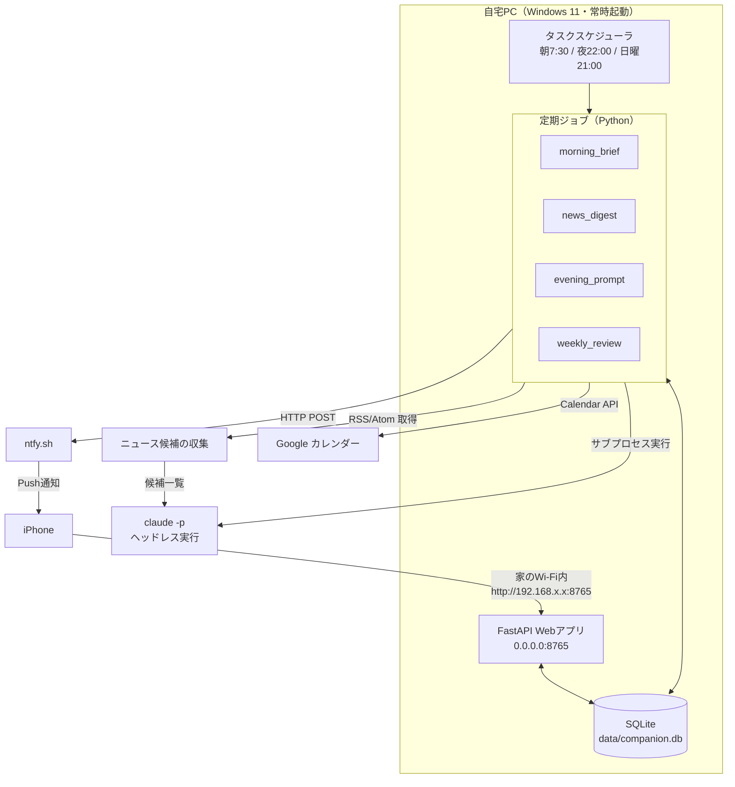
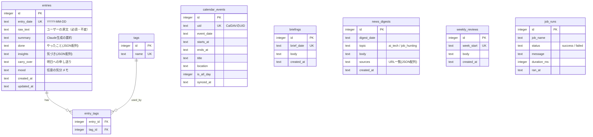

# daily-companion 要件定義書

個人用の日記兼サポート係。予定とその日の行動を1つのローカルDBに集約し、Claudeが毎朝・毎晩・毎週それを読んで話しかけてくる。

- 作成日: 2026-08-08
- 対象ユーザー: 本人1名のみ（マルチユーザー非対応）
- 稼働環境: Windows 11 デスクトップPC（常時起動を想定）

---

## 1. 背景と目的

### 解決したい課題

| 課題 | 現状 | 目指す状態 |
|---|---|---|
| その日やったことが流れて消える | 記録していない | 夜に一言返すだけで構造化されて残る |
| 予定を把握しないまま朝が始まる | Appleカレンダーを都度開く | 朝に今日の予定＋昨日の振り返りが届く |
| 情報収集が続かない | ニュースを見る習慣がない | 興味分野だけ要約されて届く |
| 振り返りをしない | — | 週次で傾向・やり残しが自動で出る |

### 非目標（やらないこと）

- 他人との共有・マルチユーザー対応
- スマホアプリのネイティブ開発（ブラウザで完結させる）
- 予定の**作成/編集**をアプリ側から行うこと（Phase 1では読み取り専用）
- 感情分析・スコアリングなどの高度な分析（まずは記録と要約に集中）

---

## 2. 全体アーキテクチャ

### 技術選定と理由

| 領域 | 採用 | 理由 |
|---|---|---|
| 言語 / 環境 | Python 3.13 / uv | 導入済み。既存 discord-claude-bot と同じ構成で学習コストゼロ |
| DB | SQLite（1ファイル） | セットアップ不要、標準ライブラリ、個人規模なら性能十分、全データが手元に残る |
| Web | FastAPI + Jinja2 | 軽量。同一プロセスでHTML配信とAPIを兼ねられる |
| AI | `claude -p` ヘッドレス実行 | 既存botで**運用実績あり**。APIキー従量課金が不要 |
| カレンダー | Google Calendar API（サービスアカウント） | 無人ジョブ向き。ブラウザ再同意もトークン失効もなく、一度共有すれば動き続ける |
| 通知 | ntfy.sh | アプリ入れてトピック名決めるだけ。サーバー実装・認証不要でPushが飛ぶ |
| 常駐 / 定期実行 | Windowsタスクスケジューラ（S4U） | 既存botで実績あり。ログイン不要で動く |

### なぜこの構成か（採用しなかった案）

- **クラウドにデプロイしない**: `claude -p` がローカルのClaude Code認証に依存するため。クラウドに置くとAnthropic APIキーの従量課金と認証実装が必要になり、初期コストが一気に上がる。
- **外部公開しない**: 個人の日記という機微な内容のため、インターネットに晒さない。まずは家のWi-Fi内限定とし、外出先アクセスが必要になった時点でTailscale（P2P VPN）を後付けする。
- **通知はWebと分離**: Webが家の中だけでも、通知はntfy経由で外出先にも届く。「見に行く」必要がないので習慣化しやすい。

---

## 3. 機能要件

### F-1. 夜の日記プロンプト（コア機能）

| 項目 | 内容 |
|---|---|
| トリガー | 毎日 22:00（タスクスケジューラ） |
| 動作 | ntfyで「今日は何した？」＋当日の予定一覧をPush通知 |
| 入力 | 通知タップ → Webの日記入力フォーム（自由記述） |
| 処理 | 保存時に `claude -p` へ渡し、①要約 ②タグ抽出 ③やったこと/気づき/明日への申し送りに構造化 |
| 保存先 | `entries` テーブル（原文と構造化結果の**両方**を保存） |

原文を必ず残すのは、Claudeの要約が意図とズレた場合に後から取り戻せるようにするため。

**未入力時の扱い**: 翌朝のブリーフィング時点で前日分が未入力なら、朝の通知に「昨日の記録がまだです」と1行添える。それ以上の催促はしない（プレッシャーで続かなくなるのを避ける）。

### F-2. 朝のブリーフィング

| 項目 | 内容 |
|---|---|
| トリガー | 毎日 07:30 |
| 材料 | 今日のカレンダー予定 / 昨日の日記 / 直近の「明日への申し送り」/ 未完了タスク |
| 出力 | Claudeが生成した数行のブリーフィング。ntfyでPush＋Webの当日ページに保存 |

出力に含める内容:
1. 今日の予定（時刻つき、最大5件）
2. 昨日の振り返り1行
3. 今日意識すべきこと（申し送りベース）
4. ニュース要約（F-3）へのリンク

### F-3. 自分用ニュース要約

| 項目 | 内容 |
|---|---|
| トリガー | 毎日 07:00（朝ブリーフィングの前） |
| ジャンル | **AI・IT技術** / **就活・業界動向** / **就活の実践知** / **経済・市場**（`NEWS_TOPICS` で変更可能） |
| 処理 | RSS/Atom で候補記事を集め（`integrations/feeds.py`）、`claude -p` にはツールを一切与えず、候補から5件選ばせて要約させる |
| 出力 | ジャンルごとに5件、各2〜3文。`news_digests` テーブルに保存 |

**注意**: 出典URLを必ず併記し、要約のみを鵜呑みにしない。候補の見出し・抜粋は外部データであり、内容の正確性は保証されない。

**Claudeに検索させない理由**: 当初は `--allowedTools WebSearch` で探させていたが、
検索結果が1ターンごとに文脈へ積み上がり、1ジャンルあたり数百万トークンの
キャッシュ読み書きが発生していた（実測でニュースだけで1日2.3ドル相当）。
見出しを集めるのは検索エンジンでなくてもできるので、候補集めをRSSに移し、
Claudeには1回の呼び出しで「選ぶ・要約する」だけをさせている（同0.17ドル）。
URLは候補側の値だけを使い、Claudeには作らせない。

### F-4. 予定の取り込み（Google Calendar API）

| 項目 | 内容 |
|---|---|
| 方式 | Google Calendar API v3 / **サービスアカウント認証** |
| 認証 | JSON鍵ファイル（`credentials/service-account.json`、Gitには絶対に含めない） |
| 権限 | `calendar` スコープ（読み書き）。自分のカレンダーをサービスアカウントのメールアドレスに「予定の変更権限」で共有しておく |
| 同期範囲 | 過去30日 / 未来120日。繰り返し予定は `singleEvents=True` で個別展開 |
| 頻度 | 朝ブリーフィング実行時 + カレンダー画面で月を開いた時（同一範囲は5分あける） |
| 書き込み | Phase 1では行わない。実装（`create_event`）は用意済みで、Phase 4以降に有効化 |

**サービスアカウントを選んだ理由**: 毎朝7時に無人で動くジョブなので、人がブラウザで再同意する余地がない。OAuthのユーザー認証は、Google Cloudの公開ステータスが「テスト」のままだとリフレッシュトークンが7日で失効し、毎週再認証が必要になる。サービスアカウントにはこの失効がない。

**リスク**: 共有設定を忘れるとカレンダーが0個になり、原因がわかりにくい。`doctor` コマンドで「共有されたカレンダーが0個です」と共有先メールアドレス付きで明示する。

**制約**: サービスアカウントからゲストを招待する予定はドメイン全体の委任が必要。個人利用では招待者なしの予定のみを扱う。

**同期範囲を非対称にした理由**: 当初は前後7日としていたが、月カレンダーを追加したあとに、2週間先のインターンの予定が画面に出ない問題が起きた。カレンダーはローカルのキャッシュを見るため、同期範囲の外は存在しないことになる。予定は先にあるものを見たいので未来を長く取り、加えてカレンダーで月を開いたときにその月を取り込み直すようにした。

### F-5. 週次振り返りレポート

| 項目 | 内容 |
|---|---|
| トリガー | 毎週日曜 21:00 |
| 材料 | 直近7日分の日記・予定・タグ |
| 出力 | 今週の傾向 / よかったこと / やり残し / 来週の提案。`weekly_reviews` テーブルに保存しntfyで通知 |

### F-6. Webインターフェース

| 画面 | パス | 内容 |
|---|---|---|
| 今日 | `/` | 今日の予定、朝のブリーフィング、ニュース、日記入力フォーム |
| 日記詳細 | `/entries/{date}` | 指定日の原文・構造化結果・その日の予定 |
| 一覧 | `/entries` | 日付降順のリスト、タグ絞り込み |
| 週次 | `/reviews` | 週次レポート一覧 |
| 検索 | `/search?q=` | 日記の全文検索（SQLite FTS5） |

要件: **モバイルファーストのレスポンシブHTML**。iPhoneのSafariで指1本で書けること。JSフレームワークは使わず、素のHTML+最小限のCSSで作る。

---

## 4. データモデル

補足:

- `entries.entry_date` にユニーク制約を張り、1日1エントリとする。追記は同一レコードの更新。
- `job_runs` は「今朝ちゃんと動いたか」を後から確認するための実行ログ。障害調査の起点になる。
- 全文検索は `entries` に対する FTS5 仮想テーブルで実装する。

---

## 5. 非機能要件

| 項目 | 要件 |
|---|---|
| 可用性 | PCが落ちてもデータは失われない。ジョブ失敗時は次回実行で自動回復（未処理分を検出して埋める） |
| 障害時の挙動 | 外部連携（カレンダー/ニュース/通知）の失敗はアプリを止めない。ログに残して縮退動作する |
| セキュリティ | 認証情報は `.env` のみ。`.env` と `data/` は `.gitignore` 済み。Webはローカルネットワーク内限定でインターネットに公開しない |
| データ保護 | SQLiteファイルを週1回 `data/backups/` に自動コピー（世代は4つまで） |
| 性能 | Web初期表示 1秒以内。Claude呼び出しは300秒でタイムアウト |
| 保守性 | 1ファイル400行以内。ジョブは個別に手動実行できるCLIを持つ |
| コスト | 追加の月額課金ゼロ（Claude Codeサブスクリプション内、ntfy無料枠、SQLiteローカル） |

### リスクと対策

| リスク | 影響 | 対策 |
|---|---|---|
| PCの突然の電源断（診断中の既知問題） | ジョブが実行されない | SQLiteをWALモードにして破損耐性を上げる。起動時に未実行ジョブを検出して追いかけ実行 |
| サービスアカウント鍵ファイルの流出 | カレンダーを読み書きされる | `credentials/` を `.gitignore` に追加済み。流出時はGoogle Cloudで鍵を無効化して再発行 |
| カレンダーAPIの障害・権限切れ | 予定が取れない | 縮退動作（予定なしとして続行）。手入力での予定追加を代替手段として残す |
| Claudeの出力が不正なJSON | 構造化データが壊れる | パース失敗時は原文のみ保存し、`summary` をnullにする。原文は必ず無傷で残る |
| ntfyのトピック名が推測される | 通知内容が第三者に見える | 推測困難なランダム文字列をトピック名にする（例: `hattr-diary-4f9c2a8e`） |
| 日記が続かない | プロジェクトの価値が消える | 通知は1日1回まで。入力は自由記述1つだけ。構造化はすべてClaude側でやる |

---

## 6. 実装フェーズ

| Phase | 内容 | 完了条件 |
|---|---|---|
| **0. 環境構築** | ディレクトリ構成、uv環境、DB作成、外部連携の疎通確認 | ntfy通知が届く / CalDAVで予定が取れる / `claude -p` が動く |
| **1. 記録の土台** | 日記の保存・閲覧（Web）、Claude構造化、夜の通知 | スマホから日記を書いて保存できる |
| **2. 朝の配信** | カレンダー同期、朝のブリーフィング生成、タスクスケジューラ登録 | 朝7:30に通知が自動で届く |
| **3. ニュース** | RSSでの候補収集＋Claudeによる選定・要約 | 朝の通知にニュースが含まれる |
| **4. 振り返り** | 週次レポート、全文検索、タグ絞り込み | 日曜に週次レポートが届く |
| **5. 運用強化** | 自動バックアップ、ジョブ失敗の追いかけ実行、S4U常駐化 | PCを再起動しても勝手に動き続ける |

外出先アクセス（Tailscale導入）は、Phase 5 完了後に必要性を再判断する。

---

## 7. 環境変数一覧

`.env.example` を参照。実際の値は `.env` に書き、Gitには絶対にコミットしない。

| 変数 | 用途 | 取得方法 |
|---|---|---|
| `NTFY_TOPIC` | 通知先トピック名 | 自分で決める（推測困難な文字列にする） |
| `GOOGLE_SERVICE_ACCOUNT_FILE` | JSON鍵ファイルのパス | 空なら `credentials/service-account.json` を読む |
| `GOOGLE_CALENDAR_IDS` | 対象カレンダーID | 空ならサービスアカウントに共有された全カレンダーを対象 |
| `WEB_HOST` / `WEB_PORT` | Webの待ち受け | 既定 `0.0.0.0` / `8765` |
| `NEWS_TOPICS` | ニュースのジャンル | 既定 `ai_tech,job_hunting` |
| `CLAUDE_TIMEOUT_SEC` | Claude呼び出しのタイムアウト | 既定 `300` |
